<p align="center">
  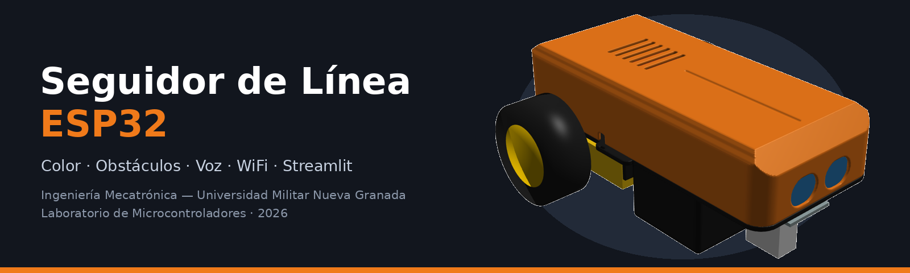
</p>

<p align="center">
  
  
  
  
  
  
</p>

<p align="center">
  <b>Robot móvil diferencial con ESP32 que sigue una línea, clasifica seis colores, evade obstáculos<br>
  y se controla por voz desde una aplicación web en Streamlit.</b><br>
  <sub>Ingeniería Mecatrónica · Universidad Militar Nueva Granada (Cajicá) · Laboratorio de Microcontroladores</sub>
</p>

---

## 🎥 Video de demostración

<p align="center">
  <a href="https://youtube.com/shorts/wufHXBLQhIQ" title="Ver el video en YouTube">
    
  </a><br>
  <a href="https://youtube.com/shorts/wufHXBLQhIQ"></a>
</p>

---

## 📑 Contenido

1. [Características](#-características)
2. [Arquitectura del sistema](#-arquitectura-del-sistema)
3. [Hardware](#-hardware)
4. [Diseño mecánico (impresión 3D)](#-diseño-mecánico-impresión-3d)
5. [Comunicación y modelo OSI](#-comunicación-y-modelo-osi)
6. [Software](#-software)
7. [Instalación y puesta en marcha](#-instalación-y-puesta-en-marcha)
8. [Simulación](#-simulación)
9. [Resultados](#-resultados)
10. [Documentación](#-documentación)
11. [Autores](#-autores)

---

## ✨ Características

| | Función | Cómo se logra |
|---|---|---|
| 🛣️ | **Seguimiento de línea** | Regleta IR de 8 canales (descarga RC) leída por registros GPIO + PID a 100 Hz |
| 🎨 | **Clasificación de color** | TCS3200: cromaticidad *r, g, b* + brillo relativo; negro, blanco, rojo, amarillo, verde y azul |
| 🧱 | **Evasión de obstáculos** | HC-SR04 cada 60 ms; rodeo rectangular y retorno en espiral a la línea |
| 🎙️ | **Control por voz continuo** | Web Speech API (es-CO) → intérprete de reglas → `GET /cmd` |
| 🧭 | **Rumbo actual y deseado** | Odometría con modelo de 1.er orden + diagrama polar en Streamlit |
| 📡 | **Telemetría WiFi** | Servidor HTTP/JSON asíncrono en el ESP32; app consulta cada 500 ms |
| 🛠️ | **Calibración desde la app** | Regleta, velocidad de giro, colores y rumbo cero; se guarda en `calib.json` |
| 🧪 | **Simulador** | Ejecuta el firmware real en el PC con periféricos simulados |

---

## 🧩 Arquitectura del sistema

<p align="center">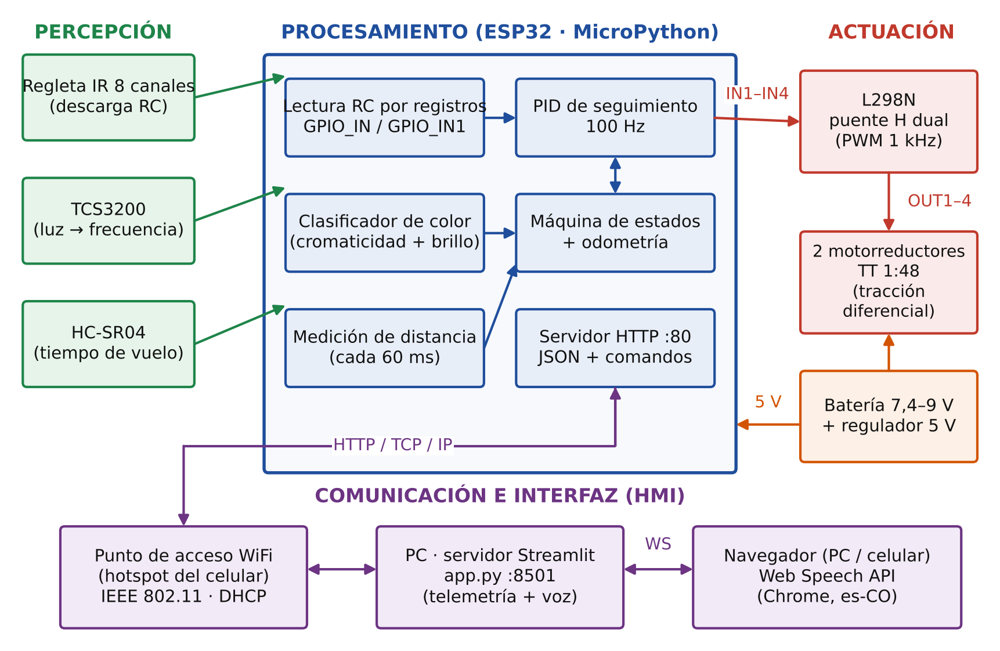</p>

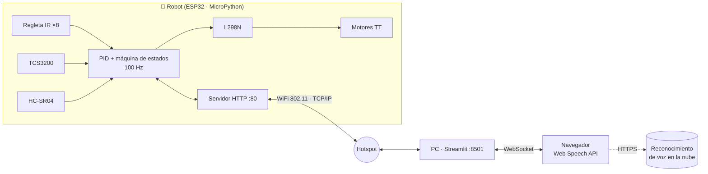

---

## 🔌 Hardware

### Lista de materiales

| Componente | Cant. | Función |
|---|:---:|---|
| ESP32 DevKit V1 (30 pines) + placa de expansión | 1 | Control, WiFi, servidor HTTP |
| Puente H L298N | 1 | Potencia de motores y regulador de 5 V |
| Motorreductor TT 1:48 con rueda Ø65 mm | 2 | Tracción diferencial |
| Regleta IR 8 canales (tipo QTR-8RC) | 1 | Posición de la línea |
| Sensor de color TCS3200 (GY-31) | 1 | Color de la superficie |
| Sensor ultrasónico HC-SR04 | 1 | Distancia a obstáculos |
| Rodachín 1″ | 1 | Apoyo delantero |
| Resistencias 1 kΩ y 2 kΩ | 1 + 1 | Divisor del Echo (5 V → 3,3 V) |
| Batería 7,4–9 V (recomendado 2×18650) | 1 | Energía |
| Chasis y carcasa impresos en PLA | — | Estructura ([STL](hardware/stl)) |

### Esquema de conexiones

<p align="center">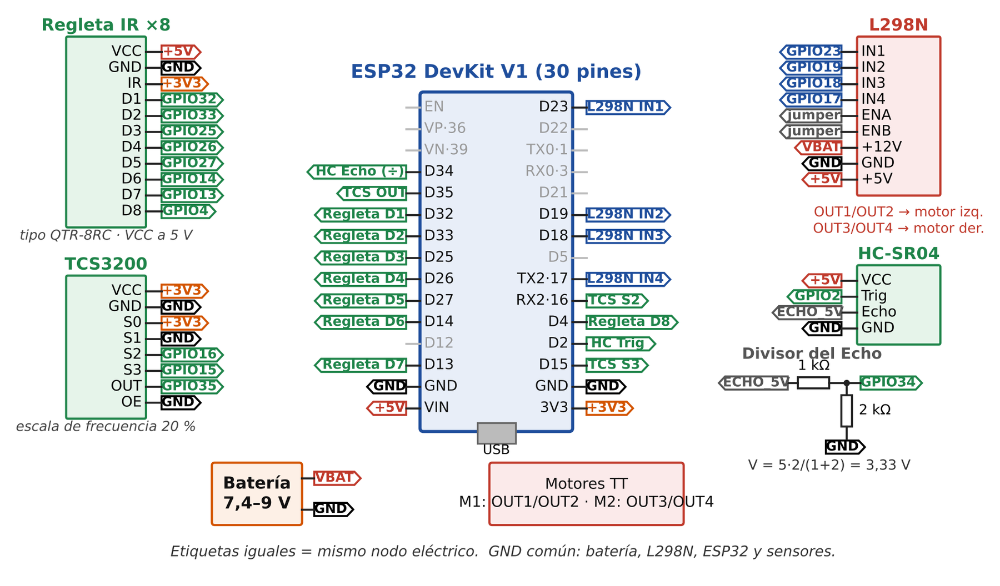</p>

<details>
<summary><b>📋 Tabla de pines (clic para desplegar)</b></summary>

| Módulo | Pin del módulo | ESP32 | Nota |
|---|---|---|---|
| Regleta IR | D1 … D8 | GPIO 32, 33, 25, 26, 27, 14, 13, 4 | VCC a **5 V** (a 3,3 V no responde) |
| Regleta IR | IR | 3V3 | LED encendidos |
| TCS3200 | S2, S3 | GPIO 16, 15 | Selección de filtro |
| TCS3200 | OUT | GPIO 35 | Solo entrada |
| TCS3200 | S0 / S1 / OE | 3V3 / GND / GND | Escala 20 % |
| HC-SR04 | Trig | GPIO 2 | |
| HC-SR04 | Echo | GPIO 34 | **Con divisor 1 kΩ / 2 kΩ** |
| L298N | IN1, IN2 | GPIO 23, 19 | Motor izquierdo |
| L298N | IN3, IN4 | GPIO 18, 17 | Motor derecho |
| L298N | ENA, ENB | jumper | PWM por IN |
| L298N | +12V / GND / +5V | Batería / GND común / VIN | Jumper del regulador puesto |

</details>

<table><tr>
<td width="50%">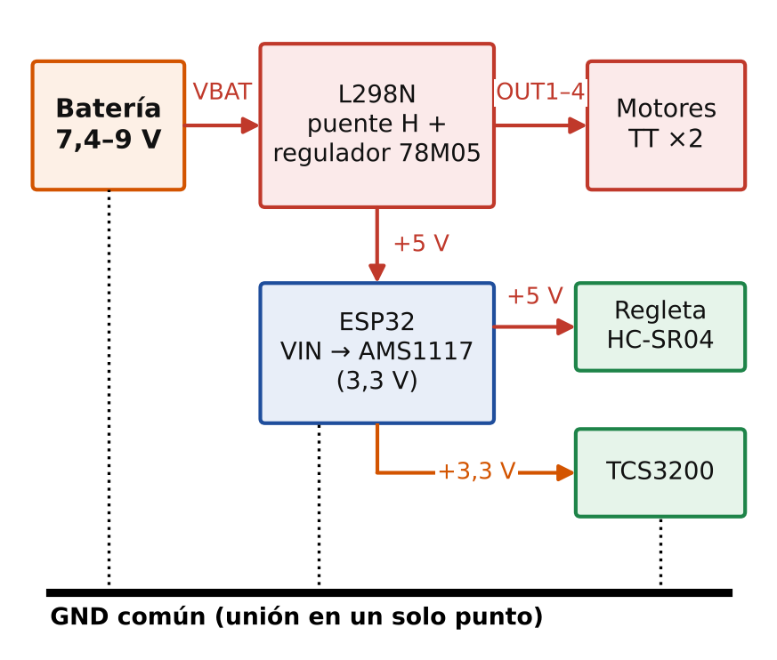<br><sub><b>Distribución de potencia.</b> GND común en un solo punto.</sub></td>
<td width="50%">

**Divisor del Echo**

| Paso | |
|---|---|
| Datos | V<sub>in</sub> = 5 V, R<sub>1</sub> = 1 kΩ, R<sub>2</sub> = 2 kΩ |
| Fórmula | V<sub>out</sub> = V<sub>in</sub>·R<sub>2</sub> / (R<sub>1</sub>+R<sub>2</sub>) |
| Sustitución | 5·2 / (1+2) |
| Resultado | **3,33 V** ✔ |

</td></tr></table>

---

## 🖨️ Diseño mecánico (impresión 3D)

El chasis se modeló **paramétricamente en Python** (funciones de distancia con signo + *marching cubes*): cambiar una medida regenera todas las piezas. Se imprimió en PLA en una Bambu Lab P1S **sin soportes**.

<p align="center">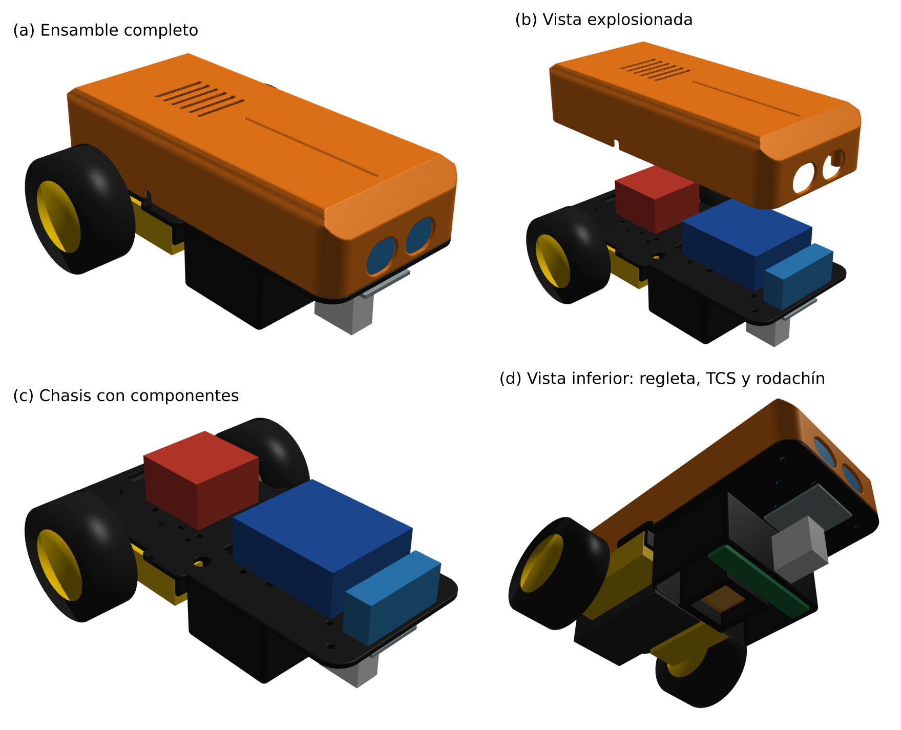</p>

<table><tr>
<td>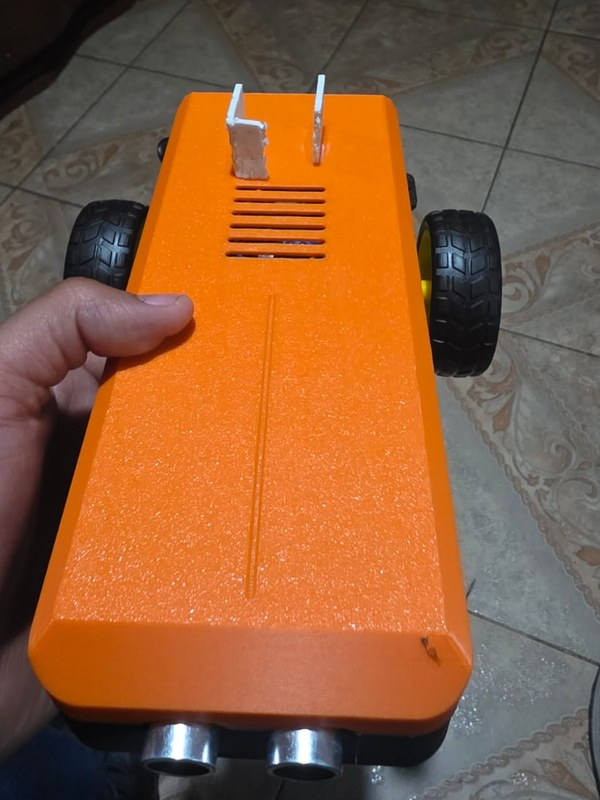</td>
<td>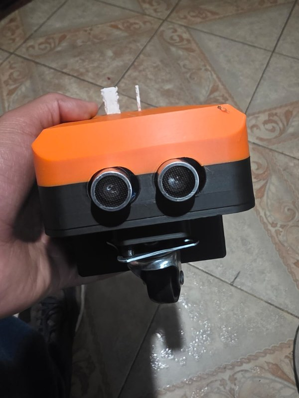</td>
<td>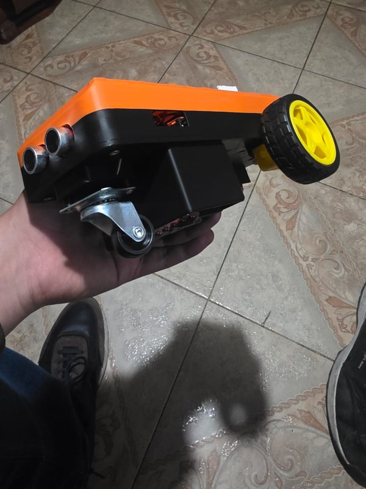</td>
<td>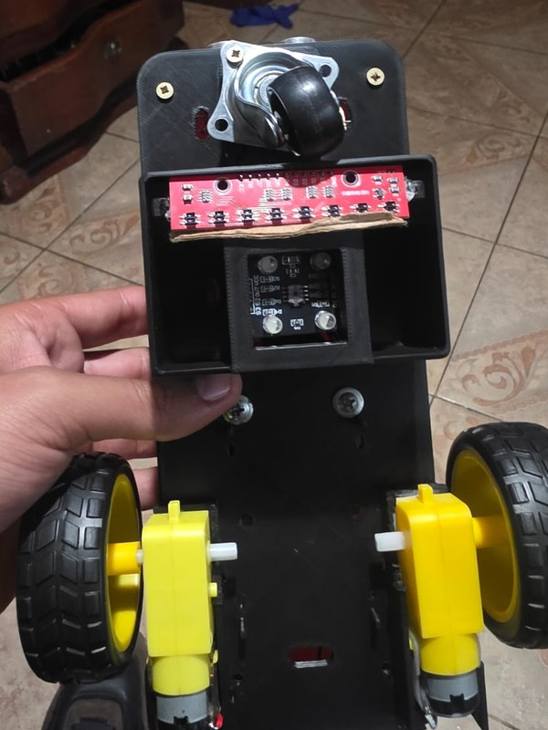</td>
</tr><tr align="center"><td><sub>Superior</sub></td><td><sub>Frontal</sub></td><td><sub>Lateral</sub></td><td><sub>Inferior</sub></td></tr></table>

**¿Por qué la rueda loca va adelante?** Con ella delante, la regleta queda *entre* los apoyos: un desnivel tiene que superar 8,2 mm para alterar la lectura (con la rueda atrás bastan 3,2 mm). Además, el robot no cabecea al frenar y en curva sale de nariz (subviraje), que es estable.

| Indicador | Rueda loca atrás | **Rueda loca adelante** |
|---|:---:|:---:|
| Carga en ruedas motrices | 88 % | 67,5 % |
| Margen de vuelco longitudinal | 0,35 | **1,74** |
| Desnivel que altera la lectura | 3,2 mm | **8,2 mm** |
| Límite en curva | sobreviraje | **subviraje** |
| Rigidez del soporte del sensor | 1× | **18×** |

| Archivo | Pieza | Masa aprox. |
|---|---|---|
| [`final_chasis.stl`](hardware/stl/final_chasis.stl) | Base (boca abajo) | 66 g |
| [`final_carcasa.stl`](hardware/stl/final_carcasa.stl) | Carcasa (boca abajo) | 57 g |
| [`final_calza_rueda.stl`](hardware/stl/final_calza_rueda.stl) | Calza del rodachín | 6 g |
| [`final_separadores.stl`](hardware/stl/final_separadores.stl) | Suplementos 1 y 2 mm | 1 g |

> Tolerancias: M3 pasante Ø3,4 · tuerca M3 5,8 × 2,6 · cuna del motor 19,3 (motor de 18,8) · ojos del HC-SR04 Ø16,6. Detalles en [`hardware/`](hardware).

---

## 📡 Comunicación y modelo OSI

<table><tr>
<td width="42%">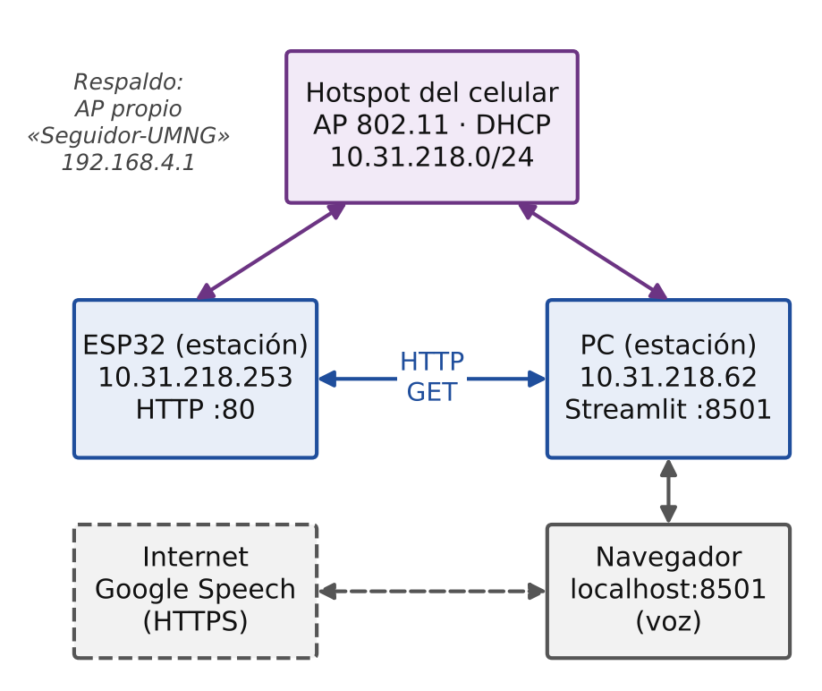</td>
<td>

| Capa OSI | Protocolo en el proyecto |
|---|---|
| 7 · Aplicación | HTTP/1.1 (`/estado`, `/cmd`), Streamlit |
| 6 · Presentación | JSON · UTF-8 · codificación URL |
| 5 · Sesión | `Connection: close` (ESP32) · WebSocket (app) |
| 4 · Transporte | TCP (puertos 80 y 8501) |
| 3 · Red | IPv4 + DHCP (10.31.218.0/24) |
| 2 · Enlace | IEEE 802.11 MAC · WPA2 · ESP-NOW |
| 1 · Física | Radio 2,4 GHz 802.11 b/g/n |

</td></tr></table>

<p align="center">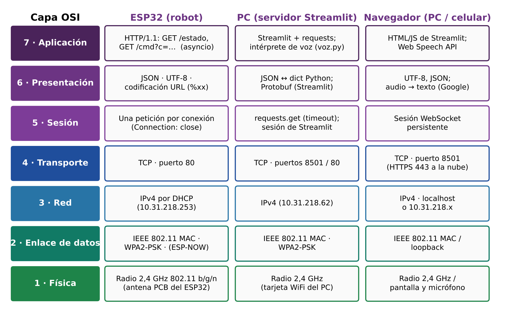</p>

**Conexión:** el ESP32 entra como estación al hotspot (WPA2), recibe IP por DHCP y anuncia el nombre `seguidor`. Si en 15 s no encuentra la red, crea su propio AP **«Seguidor-UMNG»** (`192.168.4.1`).

### API HTTP del robot (puerto 80)

| Petición | Efecto |
|---|---|
| `GET /estado` | Telemetría JSON: modo, estado, rumbo, rumbo deseado, regleta, color, distancia, eventos |
| `GET /cmd?c=auto` · `manual` · `parar` | Modo de operación |
| `GET /cmd?c=adelante` · `atras` · `izquierda` · `derecha` | Movimiento manual |
| `GET /cmd?c=rumbo:90` · `girar:-45` | Orientar / girar |
| `GET /cmd?c=vel:60` · `pid:38,3.2` · `ajuste:-4` | Ajustes en caliente |
| `GET /cmd?c=cal_linea` · `cal_giro` · `cal_color:rojo` · `cero` | Calibraciones |

### Flujo de un comando de voz

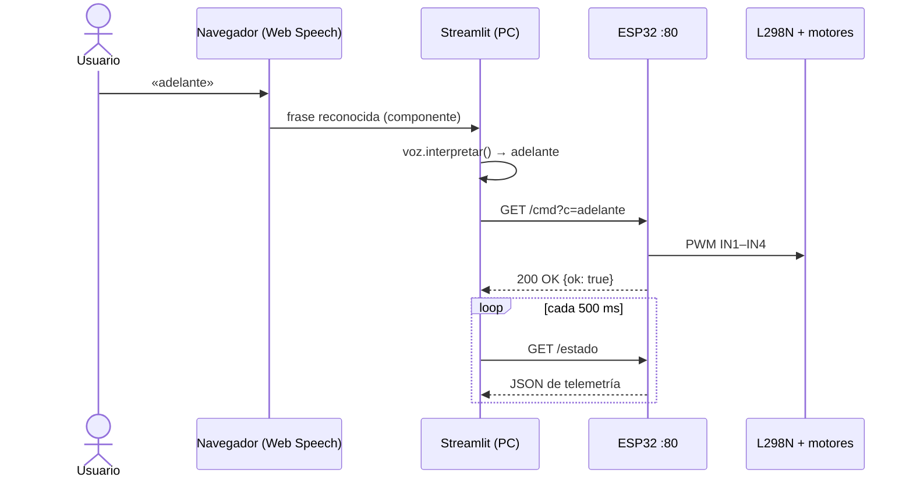

---

## 💻 Software

```text
seguidor-linea-esp32/
├── firmware_esp32/        ← se sube al ESP32 con Thonny
│   ├── main.py            # tareas asyncio, máquina de estados, servidor HTTP
│   ├── config.py          # WiFi, pines y parámetros (¡edita aquí!)
│   ├── regleta.py         # lectura RC por registros GPIO
│   ├── color.py           # TCS3200 y clasificador
│   ├── motores.py         # PWM, zona muerta y ajuste de rectitud
│   ├── odometria.py       # estimación de rumbo
│   ├── ultrasonido.py     # HC-SR04
│   ├── brujula.py         # QMC5883L / HMC5883L (opcional)
│   └── prueba_*.py, medir_colores.py   # pruebas de hardware
├── app_streamlit/         ← se ejecuta en el PC con VS Code
│   ├── app.py             # panel, diagrama polar, voz
│   ├── voz.py             # intérprete de comandos en español
│   ├── cliente.py         # peticiones HTTP al robot
│   └── escucha_continua/  # componente de voz continua
├── simulacion_pc/         ← el firmware real corriendo en el PC
├── hardware/              ← STL y scripts del CAD paramétrico
├── docs/                  ← informe IEEE (PDF/DOCX), figuras y guía
└── media/                 ← banner y video
```

<table><tr>
<td width="55%">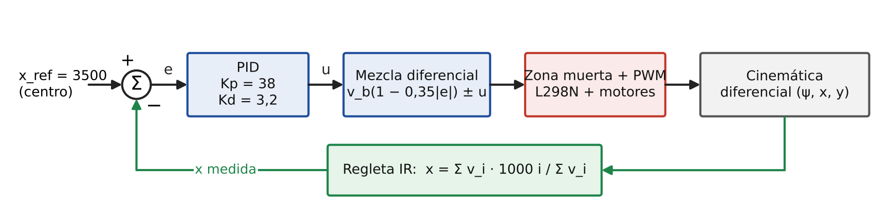<br><sub>Lazo de control: PID (K<sub>p</sub> = 38, K<sub>d</sub> = 3,2) sobre la posición de la línea.</sub></td>
<td>

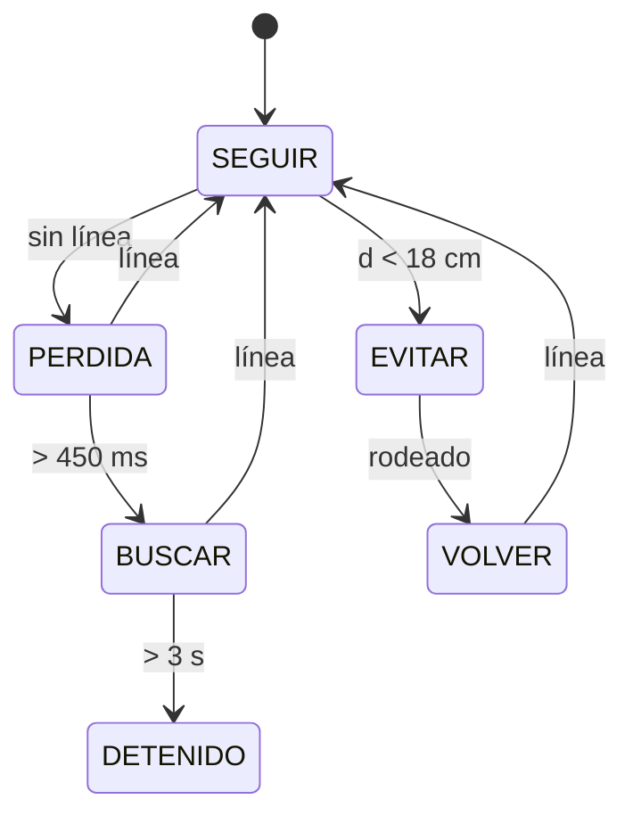

</td></tr></table>

<p align="center">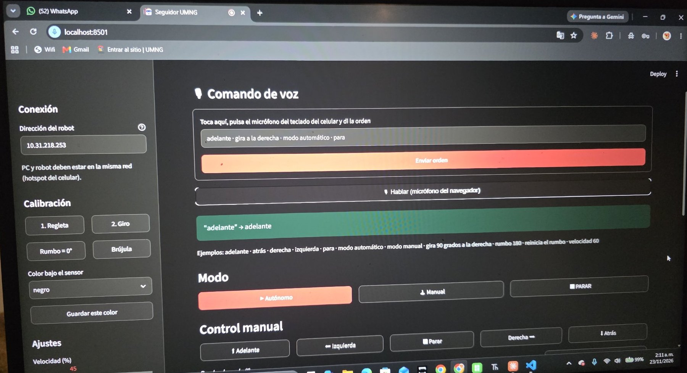<br>
<sub>Aplicación Streamlit: el comando hablado «adelante» se interpreta y se envía al robot.</sub></p>

---

## 🚀 Instalación y puesta en marcha

### 1 · Firmware (Thonny)

1. Instala **MicroPython** en el ESP32: *Herramientas → Opciones → Intérprete → MicroPython (ESP32) → Instalar o actualizar*.
2. En [`firmware_esp32/config.py`](firmware_esp32/config.py) escribe tu red:
   ```python
   WIFI_SSID = "NombreDeTuHotspot"
   WIFI_PASS = "TuClave"
   ```
3. Sube **todos** los `.py` de `firmware_esp32/` al ESP32 (*clic derecho → Subir a /*).
4. Prueba el cableado con `prueba_hardware.py` (F5, robot en el aire).
5. Pulsa **Ctrl+D**: la consola imprime `WiFi conectado. Abre http://<IP>`.

### 2 · Aplicación (VS Code)

```bash
cd app_streamlit
pip install -r requirements.txt
streamlit run app.py
```

- En el **PC** abre `http://localhost:8501` (el micrófono solo funciona en localhost o HTTPS).
- En el **celular** abre la *Network URL* que muestra la terminal (`http://IP-del-PC:8501`) y dicta con el micrófono del teclado.
- En la barra lateral escribe la **IP del robot**.

### 3 · Calibración (desde la app, en este orden)

| # | Botón | Qué hacer |
|:-:|---|---|
| 1 | **Regleta** | Robot sobre la línea; oscila 4 s |
| 2 | **Giro** | Robot centrado sobre un tramo recto |
| 3 | **Guardar este color** | Sensor sobre cada color de la pista (6 veces) |
| 4 | **Rumbo = 0°** | Fija la orientación de referencia |
| 5 | **▶ Autónomo** | ¡A rodar! |

### Comandos de voz

`adelante` · `atrás` · `izquierda` · `derecha` · `para` · `modo automático` · `modo manual` · `gira 90 grados a la derecha` · `rumbo 180` · `reinicia el rumbo` · `velocidad 60`

> Guía detallada y solución de problemas: [`docs/GUIA_DE_USO.md`](docs/GUIA_DE_USO.md)

---

## 🧪 Simulación

El simulador reemplaza los módulos `machine` y `network` por modelos de los periféricos y ejecuta **el mismo firmware** del robot.

```bash
cd simulacion_pc
python prueba_sin_brujula.py
```

<table><tr>
<td width="45%">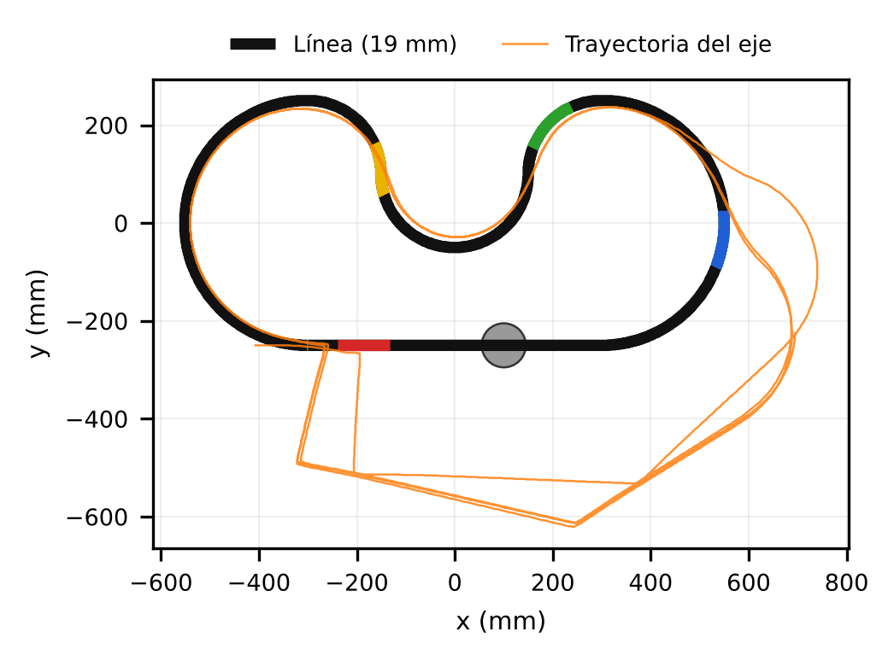</td>
<td>

| Indicador (60 s) | Resultado |
|---|---|
| Vueltas sin obstáculo | 4,69 (≈244 mm/s) |
| Colores detectados | 4 de 4 |
| Rodeos / colisiones | 4 / 0 |
| Giro calibrado / real | 206,7 / 206,7 °/s |
| Frases de voz interpretadas | 18 de 18 |

</td></tr></table>

---

## 📊 Resultados

| Función | Estado en la presentación |
|---|:---:|
| Clasificación de color (TCS3200) | ✅ |
| Detección de obstáculos (HC-SR04) | ✅ |
| Modo manual por voz y desde la app | ✅ |
| Telemetría y rumbo en diagrama polar | ✅ |
| Rumbo con brújula digital | ⚠️ estimado por odometría |
| Seguimiento de línea en la pista oficial | ❌ |

### Lección aprendida: el infrarrojo no ve las tintas de color

<table><tr>
<td width="38%">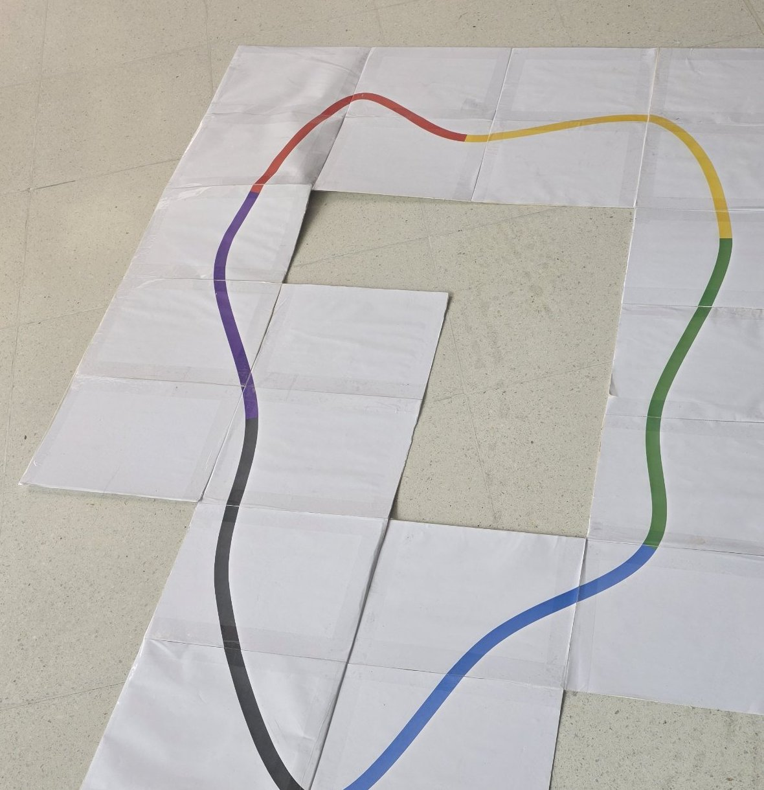</td>
<td width="62%">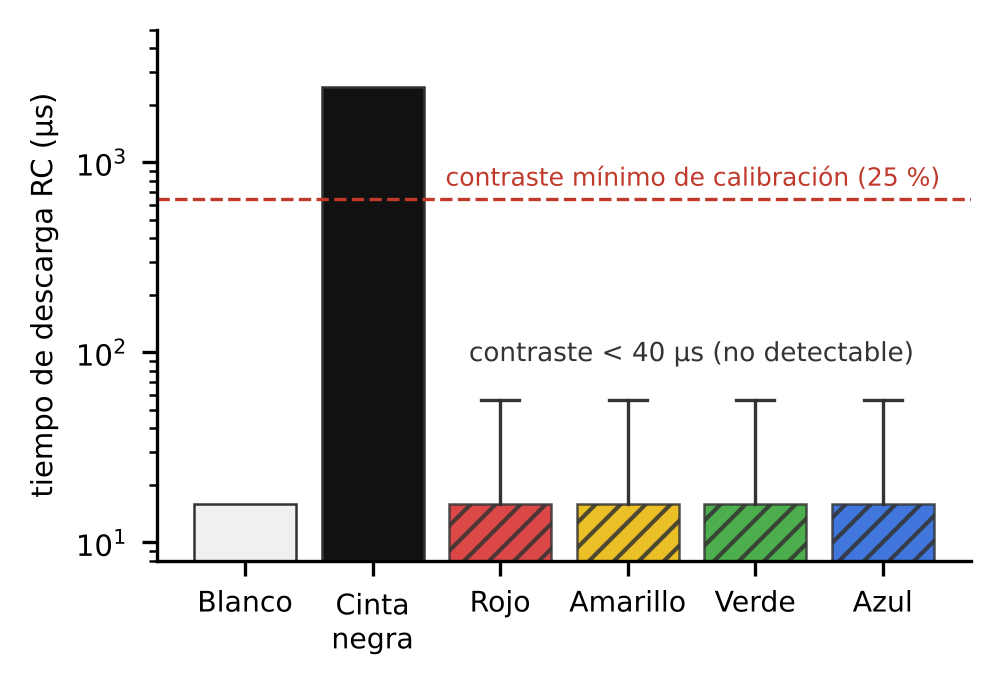</td>
</tr></table>

La pista oficial tiene la línea impresa **en color**. La regleta mide en el infrarrojo cercano (~940 nm): sobre cinta negra marca **2500 µs**, pero sobre rojo, amarillo, verde o azul lee casi lo mismo que sobre el papel blanco (**< 40 µs** de contraste). Las tintas de color absorben la luz visible pero son casi transparentes al infrarrojo; solo las tintas con negro de carbono lo absorben. Por eso el robot perdía la línea al salir del tramo negro.

**Soluciones propuestas:** seguir el borde de la línea con el TCS3200 (solo firmware), usar LED visibles en la regleta, una regleta RGB o una cámara.

---

## 📚 Documentación

| Documento | Descripción |
|---|---|
| 📄 [Informe IEEE (PDF)](docs/Informe_IEEE_Robot_Seguidor_ESP32.pdf) | Artículo completo: marco teórico, diseño, OSI, resultados |
| 📝 [Informe IEEE (Word)](docs/Informe_IEEE_Robot_Seguidor_ESP32.docx) | Versión editable |
| 🛠️ [Guía de uso](docs/GUIA_DE_USO.md) | Paso a paso, calibración y problemas frecuentes |
| 🖨️ [Hardware](hardware) | STL, CAD paramétrico y análisis de la rueda loca |

---

## 👥 Autores

| | Nombre | Rol |
|:-:|---|---|
| 🧑‍💻 | **Bryan Andrey Martínez Montaño** · [@BryanM28-git](https://github.com/BryanM28-git) | Diseño, construcción y programación |
| 🧑‍💻 | **Nicolás Santiago Pulido Buitrago** | Diseño, construcción y programación |

<sub>Programa de Ingeniería Mecatrónica · Universidad Militar Nueva Granada · Sede Campus Nueva Granada, Cajicá · 2026</sub>

## 📄 Licencia

Distribuido bajo licencia [MIT](LICENSE).
